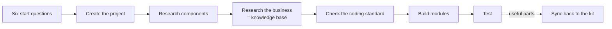

# CRM Kit

A Claude Code plugin for building a CRM for any industry to one standard. You name the industry; the kit researches it, writes the requirements, checks the coding standard, builds the app and tests it. It stops for your go-ahead after every step.

It comes from [PolicyDesk](https://github.com/AbdulSubhan1/policydesk) ([live demo](https://policydesk-opal.vercel.app/login)), an insurance CRM built from scratch with its own UI library and a strict coding standard. The kit keeps all of that and none of the insurance.

## Install

In Claude Code (2.1.275 or later), one step:

```
/plugin install crm-kit --marketplace AbdulSubhan1/crm-kit
```

Or in two steps on older versions:

```
/plugin marketplace add AbdulSubhan1/crm-kit
/plugin install crm-kit
```

Then say: **"Use the CRM kit to build a CRM for gyms"**.

## What happens



1. **Six start questions:** industry, app name, country, languages, currency, brand colour. Skip any and the kit suggests one (for Pakistan: English + Urdu, PKR).
2. **Create:** a new project from `template/`, a working app with no business in it.
3. **Research components:** study the industry's leading products and good UI libraries, then add the missing components to the library.
4. **Research the business:** how the industry runs in your country, written as an in-app knowledge base with sources. This is the requirements. The kit decides what research settles, and asks you the rest with an explanation and a recommendation.
5. **Check the standard:** compare `AGENTS.md` with current Next.js, React, OWASP and WCAG guidance, and propose changes with sources.
6. **Build:** module by module, copying the kit's module pattern; `npm run check` must pass after each module.
7. **Test:** Playwright tests for each role and journey.

## What every CRM starts with

- Next.js 15 App Router, Server Components and Server Actions, TypeScript strict, Tailwind CSS 4, Drizzle with Neon Postgres (PGlite locally), React Hook Form + Zod.
- **Database-driven access control:** a role permission matrix plus all / team / own data scopes in every query; records outside the scope are a real 404.
- **An audit trail** with a timeline per record; UUID links and human references like `MEM-J2M3HX7`.
- **i18n:** English plus the market's languages, right to left where needed, for the interface and stored data.
- **Its own UI library:** 54 components in 13 categories, with a docs-style component library in the app and lint rules that ban raw controls, inline styles and outside UI libraries.
- **A knowledge base** at `/kb` with Mermaid diagrams, starting with a training guide.
- **Quality:** `npm run check` (types, lint, Prettier, UI registry), Playwright on demand, CI and an AI PR reviewer that follows `AGENTS.md`.

## The kit keeps learning

When a CRM builds something generally useful, such as a new component or a better rule, `sync-back` copies it into the kit. It refuses files that contain business words, then bumps the version and adds a changelog entry, so the next CRM starts with it. See [CHANGELOG.md](CHANGELOG.md).

## Inside

| Path | What |
| --- | --- |
| `skills/` | `new-crm`, `research-components`, `research-business`, `standards`, `build-module`, `test`, `sync-back` |
| `template/` | The starter app |
| `references/` | Research method, component checklist, knowledge-base format, question format, standards sources, market defaults, and the module pattern |
| `scripts/` | `create`, `configure`, `sync-back` and the kit self-check, with tests (`npm test`, `npm run check`) |

## License

MIT
