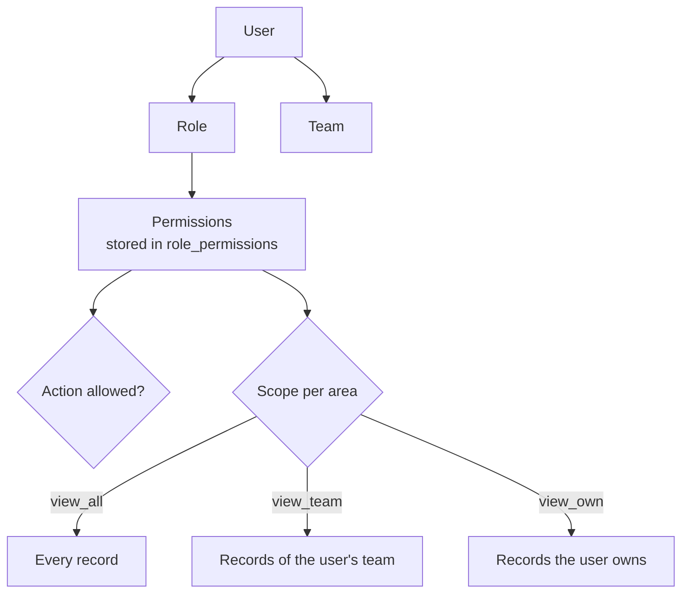

# Roles and access

Access is controlled in two layers. **Permissions** decide what someone can do. **Scope** decides whose records they can see.

- Permissions are fixed in code (`constants/permissions.ts`); roles and their permissions live in the database and admins edit them under **Roles**.
- Each area of records has `view_all`, `view_team` and `view_own` permissions. `rowScope` in `server/queries/scope.ts` turns the widest one into a query filter. A record outside the scope returns **404**.
- The **Admin** role is locked, so nobody can remove the last way back in.

<!-- The research-business step adds: the roles of this business, what each can do, and whether teams exist and what they are called. -->

## Roles
