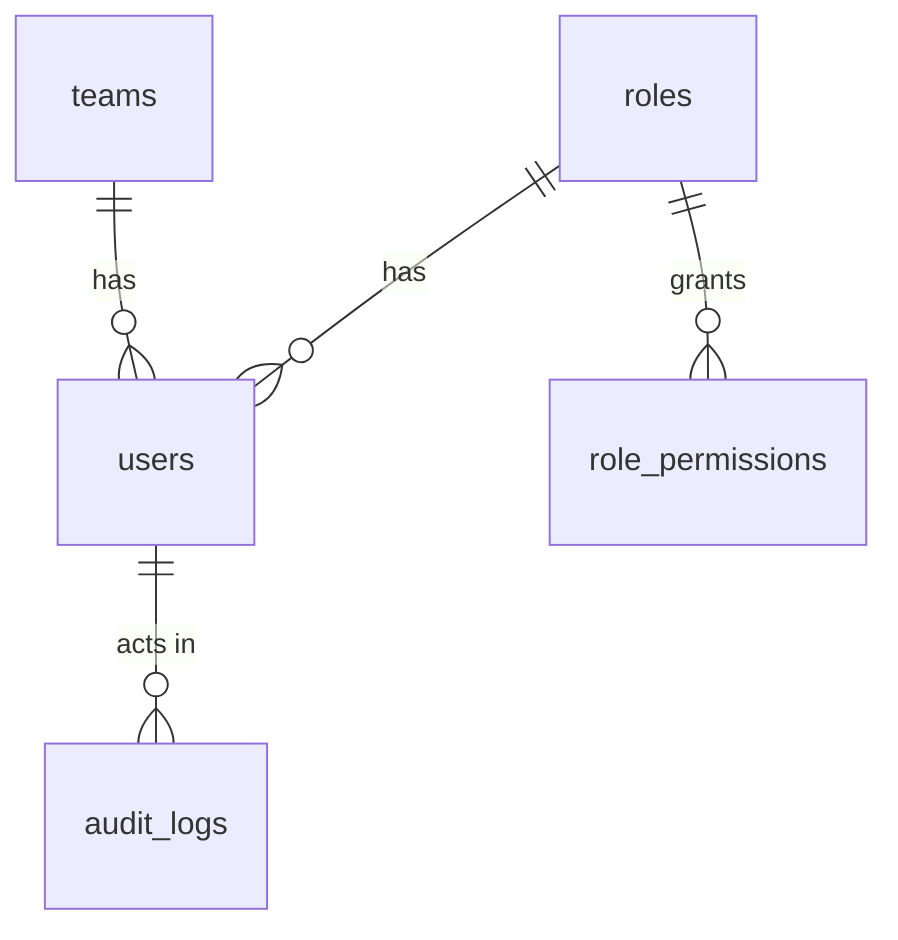

# Data model

The platform tables every CRM starts with:



- **Identifiers:** a module's records have an internal `id` for foreign keys and forms, and a `public_id` UUID used in every link, so a URL can't be guessed.
- **Audit:** every change writes `audit_logs` with `entity` and `entity_id`; a record's timeline is its rows.
- **Multi-language data:** text admins type in several languages is `jsonb` of the shape `Localized`. Read it with `localized(value, locale)`.

<!-- The research-business step adds the business tables and their relations. -->

## Changing the schema

```bash
npm run db:generate          # write a migration from schema.ts
npm run db:setup -- --reset  # local: rebuild tables and demo data
```
