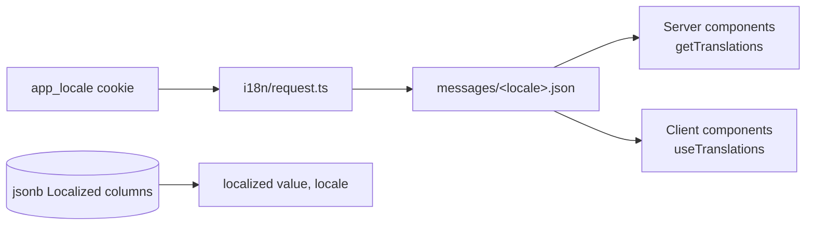

# Languages

The app's languages are set in `constants/market.ts`: English plus the market's languages, with a right-to-left layout for Arabic, Urdu and other RTL scripts. The language is a per-user choice stored in a cookie. URLs are the same in every language.

## Three kinds of text

| Kind               | Example                               | Where it lives                                    |
| ------------------ | ------------------------------------- | ------------------------------------------------- |
| Interface text     | "Save changes"                        | `messages/*.json`                                 |
| Fixed data labels  | status "Active", plan "Premium"       | Keys in `constants/`, labels in `messages/*.json` |
| Admin-entered data | Names an admin types in each language | `jsonb` columns as `Localized`                    |

Validation errors are message keys (`validation.required`), so forms show them in the user's language. Server action errors work the same way (`errors.notFound`).

## Adding a string

1. Add the key to **every** file in `messages/`, with the same keys in each.
2. Use `t("section.key")`. Keys may not contain dots, so nest objects instead.

## Adding a language

1. Add it to `LOCALES` in `constants/i18n.ts`, and to `RTL_LOCALES` if it is written right to left.
2. Add `messages/<locale>.json` with every key.
3. Admin forms that save `Localized` values need an input for the new language.
